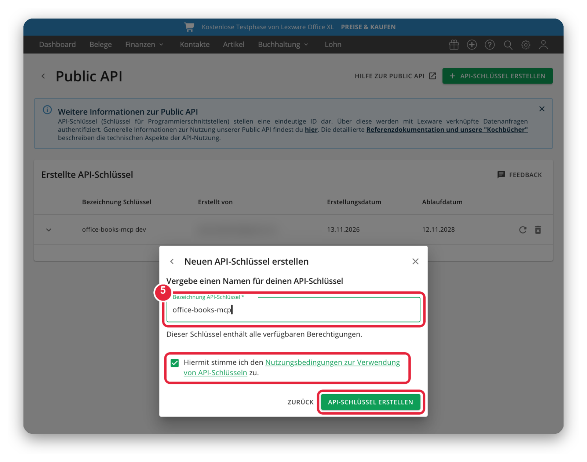

<div align="center">


# office-books-mcp

Ask your AI assistant about your Lexware Office books, safely.

    

[Star](https://github.com/mjmirza/office-books-mcp) &nbsp;|&nbsp; [Sponsor](https://github.com/sponsors/mjmirza) &nbsp;|&nbsp; [Follow on GitHub](https://github.com/mjmirza) &nbsp;|&nbsp; [next8n.com](https://next8n.com)

<sub>The Lexware logo above is a trademark of Lexware GmbH (Haufe Group), shown only to identify the service this tool connects to. This project is independent and is not affiliated with, endorsed by, or sponsored by Lexware GmbH or the Haufe Group, and claims no rights to the logo. Answers are not tax advice. Full disclaimer in <a href="docs/TRADEMARKS.md">docs/TRADEMARKS.md</a>.</sub>

</div>

## What you get

- **Answers from your real books.** "Which invoices are overdue?", "What did we buy from this vendor in March?", "Show me the contact for Müller GmbH."
- **Read only for now.** This preview cannot create, change or delete anything in Lexware Office.
- **Respects Lexware's limits.** Requests are paced to 2 per second, and a rate-limited call is retried automatically.
- **Clear errors.** An expired key, a missing XL plan or a timeout is explained in plain words, and your key never appears in a message.

## From install to first answer

1. In Lexware Office (XL plan), create an API key. The [step-by-step guide with screenshots](docs/SETUP.md) shows every click.

   
2. Build the server.
   ```bash
   npm install && npm run build
   ```
3. Check the key.
   ```bash
   LEXWARE_API_KEY=your-key node dist/index.js doctor
   ```
   You should see `OK. Connected to Lexware Office company "...".`
4. Add it to your MCP client, for example Claude Desktop.
   ```json
   {
     "mcpServers": {
       "office-books": {
         "command": "node",
         "args": ["/path/to/office-books-mcp/dist/index.js"],
         "env": { "LEXWARE_API_KEY": "your-key" }
       }
     }
   }
   ```
5. Ask "Which invoices are open?".

Your key stays on your machine, in the MCP client config or in `.env/.env.local`, which git ignores.

## Tools

| Tool | What it reads |
|---|---|
| `get_profile` | Company profile |
| `list_contacts`, `get_contact` | Customers and vendors |
| `list_articles`, `get_article` | Products and services |
| `list_vouchers` | Search all vouchers by type, status and date |
| `get_voucher` | Bookkeeping vouchers with booking categories |
| `get_sales_document` | Invoices, credit notes, quotations, order confirmations, delivery notes, down payment invoices, dunnings |
| `get_payments` | Payment status of a voucher |
| `list_recurring_templates` | Recurring invoice templates |
| `get_reference_data` | Countries, payment conditions, posting categories, print layouts |

## Technical overview

| Part | Choice |
|---|---|
| Language | TypeScript, Node 22+ |
| Protocol | Model Context Protocol over stdio |
| API | Lexware Office Public API at `https://api.lexware.io` |
| Rate limiting | Token bucket, 2 requests per second |
| Retries | 429 retried for every method, 5xx and network errors retried for reads only |
| Tests | node:test plus fast-check property tests |

```
src/
  api/        HTTP client, rate limiter
  tools/      MCP tool definitions
  config.ts   API key loading
  server.ts   MCP server
  index.ts    CLI (serve, doctor)
test/unit/    Unit, failure-path and property tests
```

## Development

```bash
npm test          # unit tests
npm run typecheck # strict TypeScript
npm run build     # compile to dist/
```

## License

Source-available, not open source. Free for personal, non-commercial evaluation with credit. Business use needs written consent. See [LICENSE](LICENSE) and contact through next8n.com.
