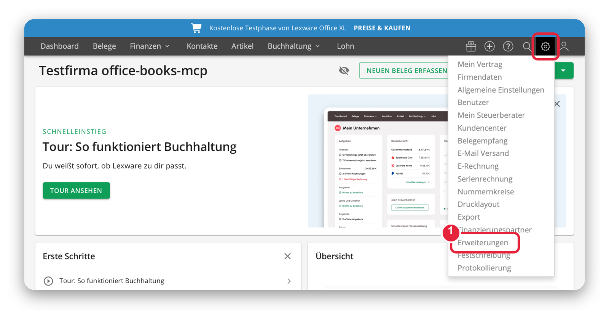
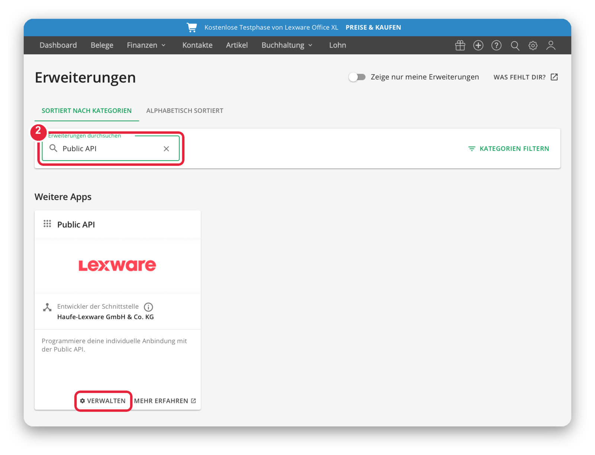
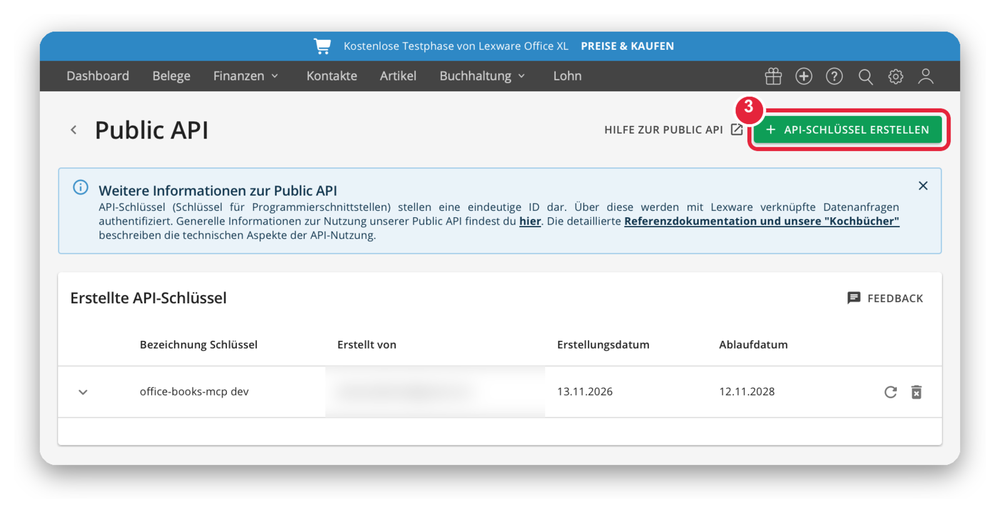
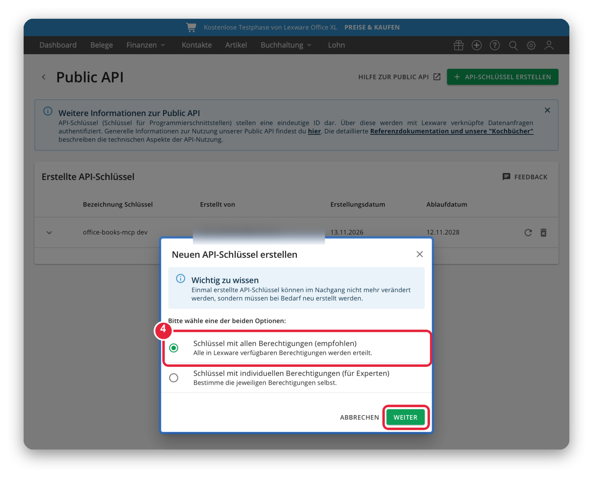
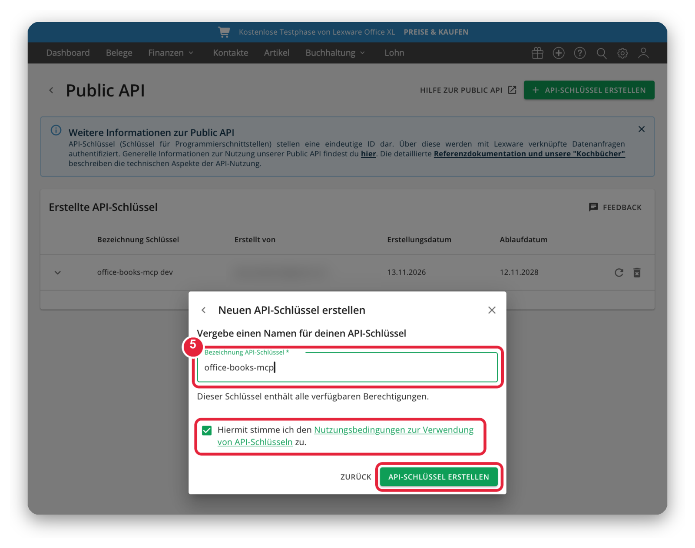

# Setup guide

About five minutes. You need Lexware Office with the XL plan (the free 30-day trial includes it) and Node 22 or newer.

> Screenshots were taken on 2026-11-13 in a Lexware Office XL trial. Personal data is blurred. Lexware screens and the Lexware logo belong to Lexware GmbH, see [TRADEMARKS.md](TRADEMARKS.md).

## 1. Open Erweiterungen

Click the gear icon at the top right, then **Erweiterungen**.



## 2. Find the Public API

Type `Public API` into the search box, then click **Verwalten** on the Public API tile.



## 3. Start a new key

Click **API-Schlüssel erstellen**. The first time, Lexware asks for your company type and VAT details. Fill them in, or the button keeps sending you back to that form.



## 4. Choose the permissions

Pick **Schlüssel mit allen Berechtigungen** and click **Weiter**. This server only reads data today, and the write tools coming next need the full set.



## 5. Name it, accept the terms, create it

Give the key a name, tick the box for the Lexware API terms of use, and click **API-Schlüssel erstellen**.



## 6. Copy the key right away

Lexware shows the key **only once**. Copy it before you close the window. It stays valid for up to 24 months. When it expires, create a new one with the renew icon next to the key.

## 7. Save the key on your machine

Never paste the key into a chat. Put it in the gitignored env file from a terminal.

```bash
printf 'LEXWARE_API_KEY=%s\n' 'PASTE_YOUR_KEY_HERE' > .env/.env.local
chmod 600 .env/.env.local
```

Or put it in your MCP client config, see the README.

## 8. Check it

```bash
npm install && npm run build
node dist/index.js doctor
```

A working key prints this line.

```
OK. Connected to Lexware Office company "Your Company".
```

`HTTP 401` means the key is wrong or expired. `HTTP 403` means the account is not on the XL plan.
